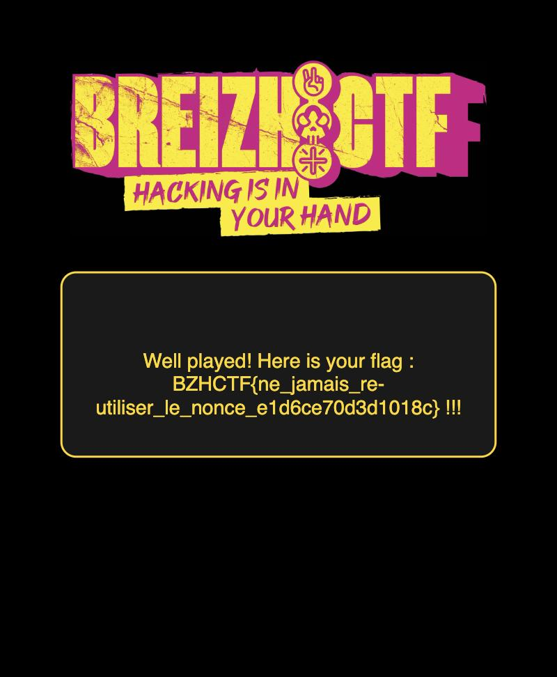

# BreizhCTF — `authentification-1` writeup

**Category:** Crypto · **Target:** `archive.cryptohack.org:61277`

> *"I secured my web application with AES-GCM implemented by the intern! Great idea, isn't it?"*

**Flag:** `BZHCTF{ne_jamais_re-utiliser_le_nonce_e1d6ce70d3d1018c}`



---

## The application

A small Flask app issues an authentication cookie when you log in. The cookie is an
AES-GCM encrypted JSON blob holding your `username` and `role`. The `/admin` route hands
over the flag only if your token decrypts to `role == "super_admin"`.

Registration always forces `role = "guest"` and `MAX_USERS = 1`, so you can never
*legitimately* become an admin — you have to break the crypto.

```python
# crypto.py
IV = b"\x00" * IV_LEN                      # (1) fixed IV

def build_token(key, username, role):
    gcm = GCM(key, IV)
    token = dumps({"username": username, "role": role}).encode()
    ct, tag = gcm.encrypt(token)
    return ";".join([ct.hex(), tag.hex()])

def verif_token(key, token):
    gcm = GCM(key, IV)
    ct, tag = [bytes.fromhex(a) for a in token.split(";")]
    pt, is_auth = gcm.decrypt(ct, tag)     # (2) is_auth is discarded!
    if loads(pt.decode())["role"] != "super_admin":
        return False
    return True
```

## Two bugs

**Bug #1 — fixed IV + fixed key = reused keystream.**
`IV` is hardcoded to all zeros and the same `MASTER_KEY` encrypts every token. AES-GCM is
CTR mode underneath, so the keystream `AES_k(J) || AES_k(J+1) || …` is **identical for every
token the server ever issues**. If I know one plaintext and its ciphertext, I know the
keystream — and I can encrypt anything I like.

**Bug #2 — the authentication tag is never verified.**
`gcm.decrypt` returns `(plaintext, is_auth)`, but `verif_token` throws `is_auth` away and
only inspects the decrypted `role`. That's the whole point of GCM's tag — tamper detection —
and it's ignored. So I don't even need to forge a valid GHASH tag; **any 16 bytes work**.

Together these turn a "tamper-proof authenticated token" into plain, malleable CTR mode.

## The attack

1. **Register + log in** as a guest. I now hold a token whose plaintext I know exactly:
   `{"username": "AAA…", "role": "guest"}`. I use a long username so the recovered keystream
   is long enough to cover my forged message.
2. **Recover the keystream:** `keystream = ciphertext XOR known_plaintext`.
3. **Forge** a new plaintext `{"username": "AAA…", "role": "super_admin"}` (padded via the
   username so it fits inside the keystream), and compute
   `forged_ct = forged_plaintext XOR keystream`.
4. **Attach a dummy tag** (`00…00`) and send `forged_ct;tag` as the `auth` cookie to `/admin`.

### One transport gotcha

The token contains a `;`, so Flask/werkzeug wraps the cookie value in quotes and
octal-escapes the `;` as `\073`. When reading the login cookie I undo that escaping; when
sending the forged token back I wrap it in quotes myself — `Cookie: auth="ct;tag"` — so the
`;` stays inside the value instead of being treated as a cookie separator.

## Exploit

```python
import requests, json, re

URL = "http://archive.cryptohack.org:61277"
s = requests.Session()
s.get(f"{URL}/reset-db")                       # fresh key/state

username  = "A" * 40
known_pt  = json.dumps({"username": username, "role": "guest"}).encode()

s.post(f"{URL}/register", data={"username": username, "password": "x"}, allow_redirects=False)
r = s.post(f"{URL}/login", data={"username": username, "password": "x"}, allow_redirects=False)

# dequote Flask cookie: strip quotes, undo octal escapes
raw = r.cookies["auth"]
if raw.startswith('"') and raw.endswith('"'):
    raw = raw[1:-1]
raw = re.sub(r'\\([0-7]{3})', lambda m: chr(int(m.group(1), 8)), raw).replace('\\\\', '\\')
ct_hex, _ = raw.split(";")

keystream = bytes(c ^ p for c, p in zip(bytes.fromhex(ct_hex), known_pt))

target = json.dumps({"username": "A" * 30, "role": "super_admin"}).encode()
forged = bytes(p ^ k for p, k in zip(target, keystream)).hex() + ";" + "00" * 16

r = s.get(f"{URL}/admin", headers={"Cookie": f'auth="{forged}"'})
print(re.search(r"BZHCTF\{[^}]*\}", r.text).group(0))
```

```
BZHCTF{ne_jamais_re-utiliser_le_nonce_e1d6ce70d3d1018c}
```

## Takeaway

The flag says it all: *ne jamais ré-utiliser le nonce* — **never reuse the nonce**. A GCM
nonce must be unique per key. Reuse collapses it to malleable CTR mode, and skipping the tag
check throws away the only thing that would have caught the forgery.
