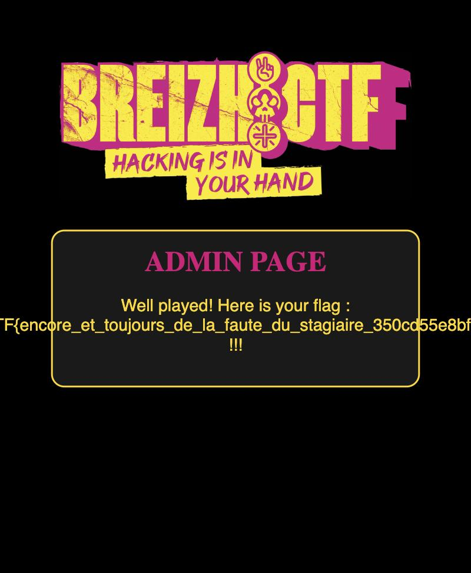

# BreizhCTF — `authentification-2` writeup

**Category:** Crypto · **Target:** `archive.cryptohack.org:59670` · 84 solves

> *"Damn, I'd forgotten to check the integrity… Good thing the intern pointed it out to me,
> he really is perfect! 😁"*
>
> Hint: there is an implementation error in `gcm.py` that you need to exploit.

**Flag:** `BZHCTF{encore_et_toujours_de_la_faute_du_stagiaire_350cd55e8bf628ea}`



---

## What changed since authentification-1

The web app is identical. The only difference is in `crypto.py` — the GCM tag is now actually
checked:

```python
def verif_token(key, token):
    ...
    pt, is_auth = gcm.decrypt(ct, tag)
    if loads(pt.decode())["role"] != "super_admin":
        return False
    if not is_auth:          # <-- added in auth-2: the forgery must have a VALID tag
        return False
    return True
```

In [authentification-1](../authentification-1/writeup/README.md) this check was missing, so a
keystream-only forgery worked. Now we need a GCM tag that genuinely verifies — which means the
hint's "implementation error in `gcm.py`".

## The bug — the tag mask reuses the data counter

Standard AES-GCM derives a pre-counter `J₀ = IV ‖ 0x00000001` and then uses:

- `J₀` **only** to mask the tag: `T = GHASH(…) ⊕ E_K(J₀)`
- `J₀ + 1, J₀ + 2, …` for the **data** keystream.

The intern's `encrypt` uses the *same* block `J` for both:

```python
def encrypt(self, P, A=b""):
    J = self.iv + b"\x00"*(CTR_LEN-1) + b"\x01"   # J0
    C = self.gctr(J, P)        # data keystream starts at J0   (should be J0+1)
    T = self.build_tag(C, A, J) # build_tag does gctr(J, S) = S ⊕ E_K(J0)
    return C, T
```

So the **first keystream block equals the tag mask**:

```
E_K(J₀)  =  keystream_block_0  =  C[0:16] ⊕ P[0:16]
```

Normally `E_K(J₀)` is the one secret value that makes a GCM tag unforgeable. Here it leaks,
because we know the plaintext of our own guest token.

## From the leak to full forgery

With one legit guest token `(C, T)` whose plaintext `P` we know:

1. **Recover the tag mask:** `E_K(J₀) = C[0:16] ⊕ P[0:16]`.
2. **Unmask the tag → GHASH:** `S = T ⊕ E_K(J₀) = GHASH(C)`.
   GHASH is `S = Σ_i B_i · H^{m−i+1}` over `GF(2¹²⁸)`, where the `B_i` are the (known) ciphertext
   + length blocks and `H = E_K(0)` is the secret auth key. That's **one polynomial equation in
   the single unknown `H`**.
3. **Solve for `H`:** find the roots of `f(H) = GHASH(C) ⊕ S = 0` in `GF(2¹²⁸)`
   (degree ≈ 4 → a couple of candidate roots; keep the ones with `GHASH(C) == S`).
4. **Forge.** We also know the full keystream `KS = C ⊕ P` (for the length of the guest token),
   so for a chosen `super_admin` plaintext `P'` (shorter than the guest token):
   - `C' = P' ⊕ KS`
   - `S' = GHASH(C')` using the recovered `H`
   - `T' = S' ⊕ E_K(J₀)`

   `auth = C'.hex() ; T'.hex()` now decrypts to `{"role": "super_admin"}` **with a valid tag**.

Register with a long username (e.g. `"A"*10`) so the guest token is long enough that `KS` covers
the (shorter) forged `super_admin` plaintext. Submit each candidate `H`'s token to `/admin`; the
real one returns the flag.

```
[*] guest token recovered: ct=43B tag=16B pt_len=43
[*] recovered 1 candidate H value(s)
[*] candidate 0: ACCEPTED
FLAG: BZHCTF{encore_et_toujours_de_la_faute_du_stagiaire_350cd55e8bf628ea}
```

## Files

- [`solve.py`](solve.py) — registers, logs in, recovers `E_K(J₀)`, solves for `H`, forges the
  `super_admin` token, submits it to `/admin`. (needs `requests`)
- [`gcmforge.py`](gcmforge.py) — self-contained `GF(2¹²⁸)` arithmetic (bit-exact with the
  challenge's `mul`), GHASH, polynomial root-finding, and the forgery helpers. No AES required —
  the attack never evaluates the block cipher.

```bash
python3 solve.py
```

## Takeaway

GCM's security rests entirely on `E_K(J₀)` (the tag mask) being secret and on the data keystream
using a *different* counter. Collapse those two counters into one and the first plaintext block
you know hands you the tag mask; from there a single leaked `GHASH` value is enough to solve for
the authentication key `H` and forge arbitrary authenticated messages. Not, in fact, the intern's
finest work.
