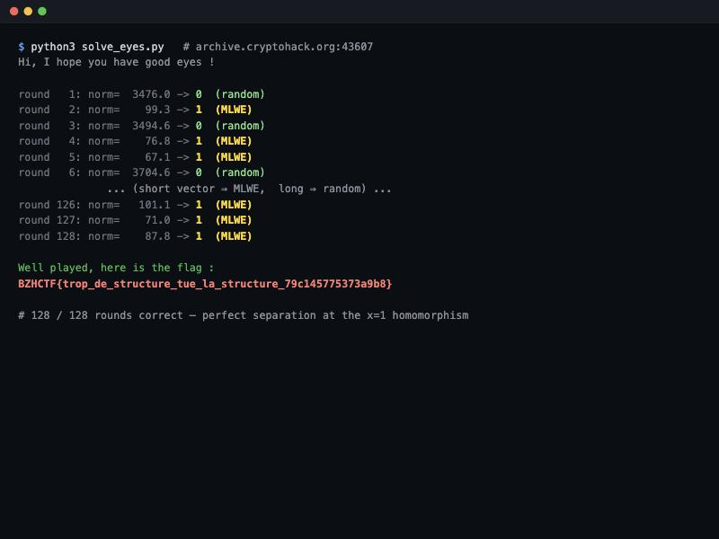

# BreizhCTF — `do-you-have-good-eyes` writeup

**Category:** Crypto (post-quantum / lattices) · **Target:** `archive.cryptohack.org:43607`

> *"Can you tell the difference?"*

**Flag:** `BZHCTF{trop_de_structure_tue_la_structure_79c145775373a9b8}`



---

## The game

The server plays a **decisional-MLWE** game. For up to 130 rounds it hands you a matrix
`A` and a vector `t` over a polynomial ring `Rq`, and asks a single yes/no question:

```python
# chal.sage
(A, t), is_mlwe = get_instance()
print(f"{sanitize_mat(A) = }")
print(f"{sanitize_vec(t) = }")
ans = int(input("MLWE (1) or not (0) ?\n> "))
```

You must answer **128 rounds correctly** to get the flag. Each instance is either:

- **MLWE** (`is_mlwe = 1`): `t = A·s + e`, with `s`, `e` having tiny coefficients in `[−2, 2]`.
- **random** (`is_mlwe = 0`): `t` is a uniformly random vector.

```python
# utils.sage
A = random_matrix(Rq, k, l)      # k=8, l=7
s = rnd_vec(Rq, l, eta)          # small, |coeff| <= 2
e = rnd_vec(Rq, k, eta)          # small
t = A*s + e                      # MLWE  ...  vs  t = random_vector(Rq, k)
```

Distinguishing MLWE from random is supposed to be **hard** — that's the whole security
assumption behind ML-DSA / Dilithium. So where's the catch?

## The bug — the wrong ring

```python
# parameters.sage  — "level 5 parameters of ML-DSA, as recommended by ANSSI"
RING_RANK = 256
q = 8380417
Rq.<X> = base_ring.quotient_ring(x^RING_RANK - 1)   # <-- x^256 - 1
```

Real Dilithium works in `Z_q[x] / (x²⁵⁶ **+** 1)`, which is **irreducible-ish** (a power-of-two
cyclotomic) — it has no small quotients. The intern typed `x²⁵⁶ **−** 1` instead.

That one sign is fatal. `x²⁵⁶ − 1` has `x = 1` as a root, so there is a **ring homomorphism**

```
φ : Rq → Fq ,   P(x) ↦ P(1) = (sum of P's coefficients)
```

φ respects `+` and `×`, so it turns the whole module equation into a tiny one over `Fq`:

```
t = A·s + e      ⟹      φ(t) = φ(A)·φ(s) + φ(e)
```

i.e. an **8×7 linear system over `Fq`** — and crucially `φ(s)`, `φ(e)` stay **small**:
each is a sum of 256 coefficients in `[−2, 2]`, so `|φ(s)ᵢ|, |φ(e)ᵢ| ≈ ±20` (std ≈ √(256·2) ≈ 22).

That's the flag's lesson: *trop de structure tue la structure* — **too much structure kills
the structure**. `x²⁵⁶ − 1` factors completely, and the `x=1` projection leaks everything.

## The distinguisher

After applying φ we have `A₁` (8×7 over `Fq`) and `t₁` (length 8). Decide:

> does there exist a **short** `(s₁, e₁)` with `A₁·s₁ + e₁ ≡ t₁ (mod q)` ?

- **MLWE:** yes — the real `(φ(s), φ(e))` is such a vector, with norm ≈ √15 · 22 ≈ **85**.
- **random:** no — the closest `(s₁, e₁)` has norm ≈ the Gaussian heuristic of the lattice,
  ≈ **4600**.

That's a ~50× gap, so it's trivially reliable. Finding the shortest `(s₁, e₁)` is a
15-dimensional closest-vector problem — solved instantly with LLL via a Kannan embedding:

```
        ┌  I₇    A₁ᵀ   0 ┐     rows for s₁ (7)
   B =  │  0    q·I₈   0 │     mod-q rows   (8)
        └  0     t₁    1 ┘     target row   (1)
```

LLL-reduce `B`; the shortest nonzero vector is ≈ 85 for MLWE and ≈ 4600 for random. Threshold
at ~1000 → answer `1` or `0`. Run output (note the clean split — small norm ⇒ MLWE):

```
round   1: norm=  3476.0 -> 0  (random)
round   2: norm=    99.3 -> 1  (MLWE)
round   3: norm=  3494.6 -> 0  (random)
round   4: norm=    76.8 -> 1  (MLWE)
...
round 128: norm=    87.8 -> 1  (MLWE)

Well played, here is the flag :
BZHCTF{trop_de_structure_tue_la_structure_79c145775373a9b8}
```

**128 / 128 correct.**

## Files

- [`solve_eyes.py`](solve_eyes.py) — connects, decodes each instance (base64 → gzip →
  `literal_eval`), evaluates at `x=1`, runs the LLL distinguisher, answers all rounds.
- [`lll.py`](lll.py) — a small self-contained float LLL + the Kannan-embedding `bdd_norm`.

### The core of the attack

```python
# evaluate every ring element at x = 1  (sum its 256 coefficients mod q)
A1 = [[sum(A[r][c]) % q for c in range(l)] for r in range(k)]
t1 = [sum(t[r])        % q for r in range(k)]

norm = bdd_norm(A1, t1, q)     # shortest (s1,e1) via LLL
answer = 1 if norm < 1000 else 0
```

## Takeaway

The security of lattice schemes like Dilithium relies on the ring having **no exploitable
structure** — `x²ⁿ + 1` is chosen precisely because it stays irreducible over the relevant
primes. Swapping in `x²ⁿ − 1` reintroduces the evaluation homomorphism `P ↦ P(1)` (and many
other factors), collapsing a hard module problem into a tiny, decodable one. Mind the sign.
