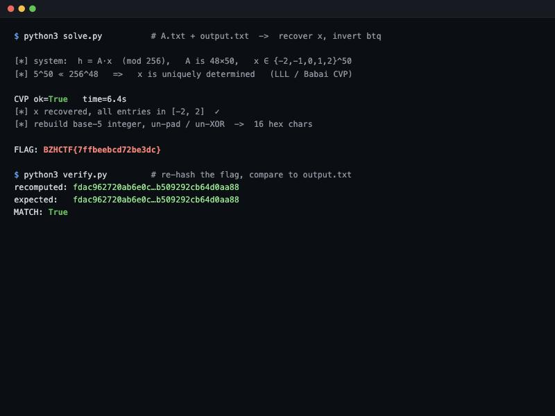

# BreizhCTF — `u-turn` writeup

**Category:** Crypto · **Files:** `chal.sage`, `utils.py`, `A.txt`, `output.txt`

> *"HaSh functIonS are one-way, right?"*

**Flag:** `BZHCTF{7ffbeebcd72be3dc}`



---

## The "hash"

The flag is `BZHCTF{<16 hex chars>}`; only the 16 hex chars are hashed. The whole hash is
**linear**:

```python
# chal.sage
k, l = 48, 50 ; n = 256 ; Zn = Zmod(n)
def hash(msg):
    msg = sanitize(msg.encode(), l)     # -> length-50 vector of small digits
    x = vector(Zn, msg)
    A = Matrix(Zn, k, l, get_a())        # public 48x50 matrix (A.txt)
    return bytes(A*x)                    # h = A·x (mod 256)
```

So the output is just `h = A·x (mod 256)`. Everything about `x` lives in `sanitize`:

```python
# utils.py
def sanitize(a, l):
    a = pad(a, 16)                       # 16-byte flag -> 32 bytes (full PKCS7 block of 0x10)
    out = b"\x00"*16
    for i in range(0, len(a), 16):
        out = xor(out, a[i:i+16])        # fold the two blocks: out = flag XOR (0x10 * 16)
    return btq(out)[:l]                  # out (128-bit int, little-endian) in BASE 5

def btq(a):                              # bytes -> quinary digits in {-2,-1,0,1,2}
    a = int.from_bytes_little(a); res = []
    while a > 0:
        res.append([-2,-1,0,1,2][a % 5]); a //= 5
    return res
```

So `x` is the **low 50 base-5 digits** of the 128-bit integer `out = flag ⊕ 0x1010…10`, with
every digit in `{−2,−1,0,1,2}`.

## Why it's invertible

A hash is meant to be one-way because it *destroys information*. This one doesn't:

- `h = A·x (mod 256)` is a **linear** map, and
- `x` is a **tiny** vector (entries in `[−2, 2]`).

There are `5⁵⁰ ≈ 2¹¹⁶` possible `x`, but the codomain has `256⁴⁸ = 2³⁸⁴` points — the short
vector `x` that produced `h` is **unique**. Recovering the unique short solution of an
inhomogeneous modular linear system is a textbook **closest-vector problem**.

## The attack

**Step 1 — recover `x`.** Find the short `x` with `A·x ≡ h (mod 256)` via a Kannan-style
embedding + LLL + Babai nearest-plane. The residue coordinates are weighted heavily so the
congruence is satisfied exactly while `‖x‖` is minimized:

```
        ┌  I₅₀    W·Aᵀ    ┐     rows for x (50)
   B =  └  0     W·256·I₄₈┘     mod-256 rows (48)      target = (0 | W·h)
```

Babai on `B` returns `x` with all entries in `[−2, 2]` — the unique preimage.

**Step 2 — invert `btq` and the padding.** The digits give `out mod 5⁵⁰`:

```
digit_i = x_i + 2          out ≡ Σ digit_i · 5ⁱ   (mod 5⁵⁰)
```

`5⁵⁰` only covers ~116 of `out`'s 128 bits, so the top ~12 bits were truncated. Enumerate the
`~2¹²` possibilities (`out = out_low + t·5⁵⁰`), decode each as 16 little-endian bytes, and keep
the one where `out ⊕ 0x1010…10` is all ASCII hex. That's the flag.

```
FLAG: BZHCTF{7ffbeebcd72be3dc}
```

**Verification** — re-hashing `7ffbeebcd72be3dc` reproduces `output.txt` byte for byte
(`fdac962720ab6e0c…b509292cb64d0aa88`).

## Files

- [`solve.py`](solve.py) — reads `../challenge/A.txt` + `output.txt`, recovers `x`, prints the flag.
- [`latcvp.py`](latcvp.py) — self-contained float-GSO LLL + Babai CVP (`solve_mod`).

```bash
python3 solve.py
```

## Takeaway

"Hash functions are one-way" only when they're **non-linear and compressing in a way that
loses information**. A linear map over `Z/256` applied to a vector you already know is small is
not a hash at all — it's a system of equations, and lattice reduction reads the input straight
back out. (The title, *u-turn*, is the whole point: the function turns right back around.)
